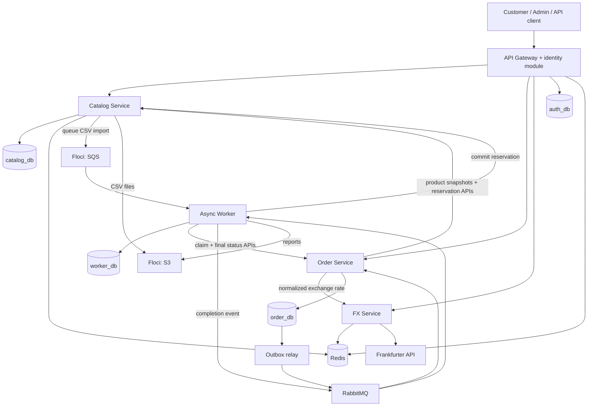
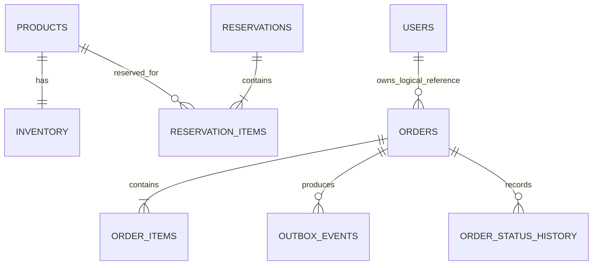
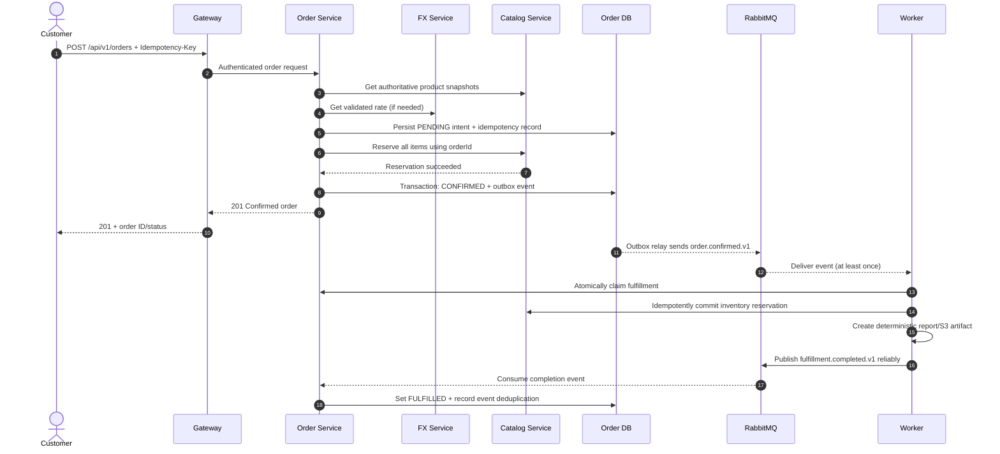

# TradeFlow — Phase 0: System Design & Requirements

> **Project:** TradeFlow — Multi-Currency Order and Inventory Management Platform  
> **Document version:** 1.0 (initial architecture baseline)  
> **Date:** 2026-10-20  
> **Status:** Proposed design for implementation and learning  
> **Development constraints:** JavaScript + Node.js (ES modules), **npm** only, free local development, no paid cloud resources, no generated starter application files

---

## 1. Executive summary

TradeFlow is a production-inspired backend for a fictional retailer that manages product catalogs, inventory, orders, currency conversions, asynchronous fulfillment, bulk imports, and reports. It will be implemented as a small microservices system, built and operated **locally first**, with a **limited free-tier demo** deployed later.

The learning goal is not only to create working CRUD endpoints. The system must demonstrate business invariants, data ownership, idempotency, database transactions, message delivery, fault tolerance, testing, and observability.

**System invariants (must always hold):**

1. A product's **available stock never drops below zero**.
2. The Catalog Service is the **only component that changes inventory**.
3. One logical order request cannot create duplicate orders when retried with the same idempotency key.
4. A confirmed order has a durable inventory reservation and an immutable price/currency snapshot.
5. An order event is not considered published until a durable outbox record can be delivered.
6. Duplicate or redelivered messages do not cause duplicate inventory consumption or reports.
7. Customers can access only their own orders; administrative actions require authorization.
8. No production-like workflow depends on actual payments, paid AWS resources, or paid cloud infrastructure.

### 1.1 Scope

**MVP (required):** account registration/login, products, inventory, orders, order status, currency conversion, inventory reservation/release/commit, message-driven fulfillment, Redis cache, CSV import via SQS, S3 reports, automated tests, metrics/tracing, Docker Compose, and an optional free Render demonstration subset.

**Out of scope for the MVP:** real money/payments, shipping-carrier APIs, tax compliance, refunds, accounting, multi-warehouse optimization, email/SMS delivery, Kubernetes, and guaranteed production availability.

**Optional extension:** MongoDB + Mongoose for a denormalized read model; not needed for the core transactional workload.

### 1.2 Constraints and assumptions

- **Budget:** $0/₱0 required service spending; use locally hosted open-source components. Do not provision a billable AWS account.
- **Package manager:** npm workspaces; do not use yarn, pnpm, or generated scaffolds.
- **Learning workflow:** write files manually during implementation; all *future code examples* should include meaningful explanatory comments.
- **Services:** five deployable applications (Gateway, Catalog, Order, FX, and Worker); worker can contain two distinct job handlers.
- **Store currency:** USD for the MVP; support display/checkout currencies such as USD, EUR, and PHP after provider validation.
- **Ordering model:** simulated checkout; an order is confirmed once inventory is reserved, not once a real payment settles.
- **Deployed demo:** may exclude RabbitMQ, SQS, and the complete monitoring stack if free hosting cannot support them; the full architecture must still run locally.

---

## 2. Stakeholders, roles, and permissions

| Role | Description | Allowed capabilities |
|---|---|---|
| Guest | Unauthenticated visitor | List active products, view product details, read public exchange rates |
| Customer | Registered and authenticated buyer | Browse, place an order, view own orders, cancel eligible orders |
| Administrator | Authorized operator | Manage products and stock, view all orders, import CSV data, request reports |
| Internal service | Authenticated service-to-service caller | Perform narrowly scoped internal operations, such as inventory reservation |

**Authorization notes:** A JWT identity is verified at the Gateway, and downstream services must not trust arbitrary user-supplied identity headers. Internal calls require a separate trusted mechanism (e.g., internal bearer credentials or signed service tokens). Local Docker networking alone is **not** authentication. All public endpoints also enforce ownership/role checks where needed.

---

## 3. Functional requirements

### 3.1 Requirements catalog

| ID | Requirement | Priority | Owner |
|---|---|---|---|
| FR-01 | Register, authenticate and authorize users | Must | Gateway identity module |
| FR-02 | Create/list/view/update/disable products | Must | Catalog |
| FR-03 | Track stock and create atomic reservations | Must | Catalog |
| FR-04 | Create orders using server-calculated totals | Must | Order |
| FR-05 | View own orders and order status | Must | Order |
| FR-06 | Cancel an eligible confirmed order and release reservation | Must | Order + Catalog |
| FR-07 | Convert prices with validated exchange rates | Must | FX |
| FR-08 | Publish order events with durable delivery | Must | Order + Worker |
| FR-09 | Process fulfillment without duplicate effects | Must | Worker + Catalog + Order |
| FR-10 | Cache exchange rates/product reads without compromising correctness | Should | FX + Catalog |
| FR-11 | Queue CSV import jobs via emulated SQS | Should | Catalog + Worker |
| FR-12 | Store CSV/report artifacts in emulated S3 | Should | Catalog + Worker |
| FR-13 | Expose health/metrics and trace requests across services | Should | All services |
| FR-14 | Run repeatable automated tests and CI checks | Must | All services |
| FR-15 | Demonstrate a public API on a free Render web service | Could | Gateway or demo app |

### 3.2 Business rules

| ID | Rule |
|---|---|
| BR-01 | Product SKU is unique within Catalog. |
| BR-02 | A product price must be nonnegative and a stock quantity must be a nonnegative integer. |
| BR-03 | `available = on_hand - reserved`; a reservation is rejected if it would make available negative. |
| BR-04 | Catalog must reserve all line items of one order atomically (all-or-none). |
| BR-05 | Client-submitted item prices and totals must be ignored; Order gets authoritative current prices from Catalog. |
| BR-06 | Confirmed orders preserve `unit_price_usd`, FX rate/date/provider, and calculated totals. |
| BR-07 | An `Idempotency-Key` is unique per customer and operation; same key/different body returns conflict. |
| BR-08 | Customers may cancel only a `CONFIRMED` order before fulfillment claims it for processing. |
| BR-09 | A cancellation releases inventory; fulfilled/processing orders cannot be cancelled in the MVP. |
| BR-10 | A fulfilled order has its reserved inventory committed exactly once. |
| BR-11 | At-least-once message delivery is expected; all consumers must be idempotent. |
| BR-12 | Imported rows must be validated individually; failed rows are reported rather than silently discarded. |
| BR-13 | No public endpoint grants access to another customer's private order information. |
| BR-14 | Exchange rates too old under the documented freshness policy cannot be used for new checkout prices. |

---

## 4. Complete user stories and acceptance criteria

### US-001 — Browse products (Customer)
**As a** customer, **I want** to browse available products, **so that** I can decide what to buy.
- Only active products are listed publicly.
- Pagination, search, and sort inputs are validated.
- Response provides SKU, name, base price, and available quantity.

### US-002 — View a product (Customer)
**As a** customer, **I want** to see product details, **so that** I can choose the correct item.
- Existing active product returns its current attributes and available quantity.
- Unknown/inactive products return `404` on the public endpoint.

### US-003 — Place an order (Customer)
**As a** customer, **I want** to order products, **so that** my inventory is reserved and the order can be fulfilled.
- At least one valid line item and a supported currency are required.
- Server independently obtains and calculates prices and FX values.
- Stock is reserved atomically and an order becomes `CONFIRMED`, or is rejected/pending according to failure policy.
- An identical retry with the same idempotency key does not create another order.

### US-004 — Track my orders (Customer)
**As a** customer, **I want** to view my order history and status, **so that** I know what happened to my purchases.
- Only orders owned by the authenticated customer are returned.
- Order details show immutable price snapshots, items, and status history.

### US-005 — Cancel an order (Customer)
**As a** customer, **I want** to cancel an eligible order, **so that** its inventory becomes available again.
- A confirmed order can be cancelled before processing begins.
- Cancellation transitions through a recoverable intermediate state until release succeeds.
- Repeated cancellation requests do not release stock twice.
- Fulfilled or processing orders return a conflict instead of changing state.

### US-006 — View converted prices (Customer)
**As a** customer, **I want** to see prices in my chosen supported currency, **so that** I understand the approximate cost.
- The FX response contains base, quote, rate, effective date, and source.
- Unsupported pairs and unavailable/stale rates generate explicit errors.
- Display prices are estimates; checkout uses its own server-side snapshot.

### US-007 — Create a product (Administrator)
**As an** administrator, **I want** to create a product, **so that** it can appear in the catalog.
- Required fields and formats are validated.
- Duplicate SKU is rejected with `409`.
- Customers receive `403` for administrator-only operations.

### US-008 — Adjust inventory (Administrator)
**As an** administrator, **I want** to correct stock counts, **so that** the catalog reflects physical inventory.
- Stock adjustments require a reason and authenticated administrator.
- Adjustments cannot make `on_hand < reserved`.
- Every adjustment records who changed the stock and by how much.

### US-009 — Disable a product (Administrator)
**As an** administrator, **I want** to disable a product, **so that** customers cannot place new orders for it.
- Disabled products disappear from public lists and cannot be newly reserved.
- Historical order items remain readable through immutable order snapshots.

### US-010 — Import products from CSV (Administrator)
**As an** administrator, **I want** to upload supplier data, **so that** many products can be maintained efficiently.
- A submitted CSV is stored in S3 emulation and a job is queued in SQS emulation.
- The worker validates, maps, and deduplicates rows; errors are reported by row.
- Job status reports total/accepted/rejected rows and does not expose secrets.

### US-011 — Generate an order report (Administrator)
**As an** administrator, **I want** to retrieve an order report, **so that** I can review fulfillment.
- A report job produces a deterministic S3 object key and downloadable metadata/reference.
- Retried jobs do not create duplicate report records.
- Access to reports is restricted to administrators.

### US-012 — Audit failures (Administrator/Operator)
**As an** operator, **I want** to see operational health and failed jobs, **so that** I can investigate incidents.
- Service health and basic metrics are available to an operator, not the general public.
- Structured logs contain correlation/trace IDs and no passwords or tokens.
- Dead-lettered messages can be inspected and intentionally replayed after a fix.

---

## 5. Non-functional requirements (measurable learning targets)

These are **local test targets**, not promised production SLAs. Measure on a documented development machine with a small seeded dataset and no third-party latency included where noted.

| Dimension | Target / criterion |
|---|---|
| Reliability | Core order/inventory invariants hold under retries and process restarts. |
| API latency | Local `GET /products` p95 < 300 ms with warm containers and representative small data. |
| Concurrency | Two requests competing for one remaining unit yield at most one successful reservation. |
| Durability | PostgreSQL data survives a Docker container restart when named volumes remain attached. |
| Testability | Domain logic is unit testable without external infrastructure; integration tests cover real dependencies. |
| Security | All nonpublic endpoints verify role/ownership; no hard-coded secrets. |
| Observability | HTTP latency/count/errors, queue backlog, and order processing outcomes can be inspected. |
| Traceability | At least one trace spans Gateway → Order → Catalog, with propagated context into a RabbitMQ consumer. |
| Portability | Local deployment uses Docker Compose and environment variables; application code does not hard-code hostnames. |
| Budget | No required credit card and no billable cloud resources; free demo can be turned off without affecting local system. |

---

## 6. Architecture and ownership

### 6.1 Container / service diagram



**Diagram note:** Boxes represent logical components; the outbox relay can run within the Order app and the import handler within the Worker app. The diagram shows service responsibilities, not a fixed number of Docker containers. Prometheus, Grafana, OpenTelemetry Collector, and Jaeger observe services and workers but are omitted from the main diagram for readability.

### 6.2 Service boundary matrix

| Component | Primary responsibilities | Persisted data it owns | May call |
|---|---|---|---|
| API Gateway / Identity | Public routing, login, JWT verification, roles, rate limit | `auth_db`: users, credentials/roles | Catalog, Order, FX |
| Catalog Service | Products, authoritative prices, stock, reservations, CSV import job state | `catalog_db` | S3, SQS |
| Order Service | Order state machine, order snapshots, idempotency, event outbox | `order_db` | Catalog, FX, RabbitMQ via relay |
| FX Service | FX provider adapter, validation, normalization, cache | Redis cache (optional persistent snapshots at order boundary) | Frankfurter |
| Async Worker | Fulfillment consumer, import worker, report generation, deduplication | `worker_db`: inbox/job execution records | RabbitMQ, Catalog, Order, S3, SQS |

**Database rule:** A shared physical PostgreSQL *server* is fine for a free learning environment; each service gets a separate database and restricted credentials. Service A must not query Service B's tables. No distributed SQL joins.

### 6.3 Why synchronous *and* asynchronous communication?

- **HTTP:** immediate checks that must resolve before confirming checkout, e.g., product lookup and stock reservation.
- **RabbitMQ:** durable business events after transaction commit, e.g., `order.confirmed.v1` and `fulfillment.completed.v1`.
- **SQS via Floci:** a separate background data-import queue for large CSV files; it is not a second bus for order events.
- **Redis:** best-effort cache and rate-limit state; not the authoritative inventory counter or durable order ledger.

---

## 7. Domain/data model

> Suggested schema fields are design documentation, not migration files. IDs are UUIDs; timestamps are UTC; monetary calculations use decimal-safe logic and database `NUMERIC` columns. Never calculate ledger-like amounts with unchecked JS floating-point arithmetic.

### 7.1 Catalog-owned tables

| Table | Key fields | Invariants |
|---|---|---|
| `products` | `id`, `sku`, `name`, `description`, `price_usd NUMERIC(12,2)`, `is_active`, `version`, timestamps | Unique SKU; nonnegative price |
| `inventory` | `product_id`, `on_hand INT`, `reserved INT`, `updated_at` | `on_hand >= 0`; `0 <= reserved <= on_hand` |
| `reservations` | `id`, `order_id`, `status`, timestamps | Unique `order_id`; states `RESERVED`, `RELEASED`, `COMMITTED` |
| `reservation_items` | `reservation_id`, `product_id`, `quantity` | Positive integer quantity; no duplicates per reservation/product |
| `stock_adjustments` | `id`, `product_id`, `delta`, `reason`, `actor_id`, `created_at` | Auditable, cannot violate reservation invariant |
| `import_jobs` | `id`, `object_key`, `status`, `accepted_count`, `rejected_count`, timestamps | Catalog owns import status |

**Inventory arithmetic:**

- **Reserve:** increment `reserved`, leave `on_hand` unchanged.
- **Release:** decrement `reserved`, leave `on_hand` unchanged.
- **Commit:** decrement both `reserved` and `on_hand` exactly once.
- **Available:** `on_hand - reserved`.

Catalog performs multi-item reservations in **one local DB transaction** with row-level locks or guarded atomic updates, unique reservation identity, and deterministic lock ordering to reduce deadlocks. A client never writes these counters.

### 7.2 Order-owned tables

| Table | Key fields | Invariants |
|---|---|---|
| `orders` | `id`, `customer_id`, `status`, `currency`, `subtotal_usd`, `total_display`, `fx_rate`, `fx_date`, `fx_provider`, timestamps | Immutable price/FX snapshot after confirmation |
| `order_items` | `id`, `order_id`, `product_id`, `sku_snapshot`, `name_snapshot`, `quantity`, `unit_price_usd`, `line_total_usd` | Positive quantities; server-sourced prices |
| `idempotency_requests` | `customer_id`, `key`, `payload_hash`, `order_id`, timestamps | Unique `(customer_id, key)`; reject different payload for same key |
| `outbox_events` | `id`, `aggregate_id`, `event_type`, `version`, `payload`, `published_at`, `attempts` | Inserted in transaction with state change |
| `order_status_history` | `id`, `order_id`, `from_status`, `to_status`, `reason`, timestamp | Auditable transitions |

### 7.3 Identity and worker tables

| Owner | Table | Purpose |
|---|---|---|
| Gateway identity module | `users` | Account ID, email, salted password hash, role, status |
| Worker | `inbox_messages` | Unique `(consumer_name, event_id)` for deduplication |
| Worker | `job_executions` | Report/import execution state and retry metadata |

**No cross-database foreign keys:** `order_items.product_id` is a stored reference, not a SQL foreign key into Catalog's database. Order retains independent historical snapshots even if Catalog later changes the product.

### 7.4 High-level ER diagram (within service boundaries)



The `USERS` → `ORDERS` relationship is **logical only**; the two tables live in different service-owned databases.

---

## 8. Order lifecycle, concurrency, and failures

### 8.1 State machine

| From | To | Trigger / condition |
|---|---|---|
| — | `PENDING` | Valid initial order intent persisted |
| `PENDING` | `CONFIRMED` | Catalog reservation succeeded and order/outbox transaction committed |
| `PENDING` | `REJECTED` | Definitive stock/business rejection; no held inventory |
| `PENDING` | `MANUAL_REVIEW` | Recovery cannot conclusively reconcile after retries |
| `CONFIRMED` | `CANCELLATION_PENDING` | Customer cancellation wins race against fulfillment claim |
| `CANCELLATION_PENDING` | `CANCELLED` | Catalog confirmed idempotent release |
| `CONFIRMED` | `PROCESSING` | Worker successfully claims fulfillment |
| `PROCESSING` | `FULFILLED` | Worker completed inventory commit/report and completion event handled |
| `PROCESSING` | `MANUAL_REVIEW` | Repeated poison failure requiring operator intervention |

`REJECTED`, `CANCELLED`, and `FULFILLED` are terminal in the MVP. Do not let cancellation and fulfillment each win the same confirmed order; Order Service uses an atomic state transition to select exactly one path.

### 8.2 Successful order sequence



**Important implementation detail:** the final worker event also needs a durable local outbox or equivalent replay-safe completion mechanism; otherwise a worker crash between finishing its work and publishing could lose the outcome. We will explicitly test this boundary.

### 8.3 Rejected stock sequence

1. Order stores `PENDING` intent and calculates a snapshot.
2. Catalog executes one atomic all-lines reservation transaction.
3. If any item lacks available stock, Catalog rolls back all reservations and replies `409 OUT_OF_STOCK`.
4. Order transitions to `REJECTED`; nothing is published for fulfillment.
5. An identical client retry with the same key retrieves the existing rejected order, not a second order.

### 8.4 Crashes and reconciliation

| Failure | Risk | Planned control |
|---|---|---|
| Order crashes *before* Catalog reservation | Stuck pending order | Recovery job retries reservation with stable `order_id`. |
| Order crashes *after* reservation but *before* confirm | Orphan stock hold | Stable reservation ID; reconcile pending intent with Catalog; confirm or release after a verified decision. |
| Order DB commits but RabbitMQ is down | Lost fulfillment trigger | Transactional Outbox; relay retries until broker acknowledgement. |
| RabbitMQ sends duplicate event | Duplicate processing | Inbox/event ID dedupe + idempotent downstream operations. |
| Worker crashes after stock commit | Stock consumed but order still processing | Retry uses same reservation/report keys; eventual completion or operator recovery. |
| Cancellation races fulfillment | Double-release or over-commit | Order state compare-and-set: only one path transitions from `CONFIRMED`. |
| FX API unavailable/stale | Incorrect conversion | Timeout, constrained retry, cache freshness validation, explicit error if no allowed rate. |
| Redis is unavailable | Slow reads/rate limiting impaired | Database remains authoritative; fail-safe security policy for rate limiting. |
| S3/SQS emulator unavailable | Import/report stalled | Job remains recoverable, retries after service restored. |

**Reservation TTL policy:** In the first implementation, a reservation is not silently expired if an order might already be confirmed. A reconciler checks order state before release. More advanced lease renewal and expiration rules can follow once this invariant is covered by tests.

### 8.5 Inventory race acceptance test

Initial state: one active product has `on_hand = 1`, `reserved = 0`.

- Two distinct customers submit orders for quantity 1 at approximately the same time.
- Catalog serializes/guards competing reservation updates in PostgreSQL.
- Exactly one reservation succeeds; the other fails with out-of-stock.
- Result: `on_hand = 1`, `reserved = 1`, `available = 0` **before** fulfillment; after successful fulfillment, `on_hand = 0`, `reserved = 0`.
- There must never be `available < 0`, two successful reservations, or duplicate commits.

---

## 9. API design standard

**Base public URL:** `/api/v1`  
**Format:** `application/json` except file-upload operations.  
**Authentication:** `Authorization: Bearer <JWT>` for protected endpoints.  
**Mutation retry:** `Idempotency-Key` on order creation; server persists key/payload hash.  
**Date/times:** UTC ISO 8601 strings.  
**Identifiers:** UUID strings.  
**Prices:** decimal strings in JSON (e.g., `"19.99"`) to avoid accidental binary float assumptions.  
**Pagination:** `page` (from 1), `limit` (bounded), with `meta.total`/`meta.page`/`meta.limit`.  
**Correlation:** accept/generate `X-Request-Id`; propagate standard `traceparent` where applicable.

### 9.1 Public endpoints

| Method | Path | Auth | Owner | Success | Common errors |
|---|---|---|---|---|---|
| POST | `/auth/register` | Public | Gateway identity | `201` | `400`, `409` |
| POST | `/auth/login` | Public | Gateway identity | `200` | `400`, `401`, `429` |
| GET | `/products` | Public | Catalog | `200` | `400` |
| GET | `/products/:id` | Public | Catalog | `200` | `404` |
| POST | `/products` | Admin | Catalog | `201` | `400`, `401`, `403`, `409` |
| PATCH | `/products/:id` | Admin | Catalog | `200` | `400`, `403`, `404`, `409` |
| POST | `/inventory/adjustments` | Admin | Catalog | `201` | `400`, `403`, `409` |
| POST | `/orders` | Customer | Order | `201` or `202` | `400`, `401`, `409`, `422`, `503` |
| GET | `/orders` | Customer/Admin | Order | `200` | `401`, `403`, `400` |
| GET | `/orders/:id` | Owner/Admin | Order | `200` | `401`, `404` |
| POST | `/orders/:id/cancel` | Owner | Order | `200` or `202` | `401`, `404`, `409` |
| GET | `/exchange-rates?base=USD&quote=PHP` | Public | FX | `200` | `400`, `422`, `503` |
| POST | `/imports` | Admin, multipart/CSV | Catalog | `202` | `400`, `403`, `413` |
| GET | `/imports/:id` | Admin | Catalog | `200` | `403`, `404` |
| POST | `/reports/orders` | Admin | Worker via Gateway | `202` | `400`, `403` |
| GET | `/reports/:id` | Admin | Worker via Gateway | `200` | `403`, `404` |

**Decision:** Public `404` for someone else's order to avoid revealing existence; the administrative listing can filter across customers with explicit role checks.

### 9.2 Internal endpoints

| Method | Path | Owner | Purpose |
|---|---|---|---|
| GET | `/internal/products/:id` | Catalog | Trusted product price/name/version snapshot |
| POST | `/internal/inventory/reservations` | Catalog | Atomically reserve all order line items |
| GET | `/internal/inventory/reservations/:id` | Catalog | Recover/check reservation state |
| POST | `/internal/inventory/reservations/:id/release` | Catalog | Idempotent release |
| POST | `/internal/inventory/reservations/:id/commit` | Catalog | Idempotent stock consumption |
| GET | `/internal/exchange-rates` | FX | Canonical rate snapshot for Order |
| POST | `/internal/orders/:id/fulfillment-claim` | Order | Atomic `CONFIRMED` → `PROCESSING` transition |
| POST | `/internal/import-jobs/:id/result` | Catalog | Idempotent progress/result update from Worker |

Internal endpoints require service authentication and should not be exposed by the public Gateway except through explicitly mapped public operations.

### 9.3 Detailed contract — `POST /api/v1/orders`

**Headers:** Bearer token, `Idempotency-Key: <opaque unique string>`.

**Illustrative request (`jsonc` — comments are documentation and are NOT part of the actual JSON sent):**

```jsonc
{
  // Desired checkout/display currency. Catalog's base currency remains USD.
  "currency": "PHP",
  // Clients specify product identifiers and quantities; never trusted prices.
  "items": [
    { "productId": "f4c6d126-45a9-4b91-9ed5-20c650058440", "quantity": 2 }
  ]
}
```

**Illustrative `201 Created` response:**

```jsonc
{
  // Stable order ID used for subsequent status requests and reservation identity.
  "data": {
    "id": "bb88405c-b20d-4375-94d7-6acd4ea918d8",
    "status": "CONFIRMED",
    "currency": "PHP",
    "subtotalUsd": "39.98",
    // The rate and totals below are examples, NOT live market quotes.
    "exchangeRate": { "base": "USD", "quote": "PHP", "rate": "57.0000000000", "date": "2026-10-19", "provider": "frankfurter" },
    "total": "2278.86",
    "items": [{ "productId": "f4c6d126-45a9-4b91-9ed5-20c650058440", "quantity": 2, "unitPriceUsd": "19.99" }]
  }
}
```

**Other outcomes:**

- `202 Accepted`: valid request persists as `PENDING` when reservation is still being resolved; include order ID and a status URL.
- `400 VALIDATION_ERROR`: empty items, non-positive quantity, bad UUID, or unsupported request shape.
- `409 OUT_OF_STOCK`: definitive inability to reserve a product; order becomes `REJECTED`.
- `409 IDEMPOTENCY_CONFLICT`: the same key is reused with a different normalized payload.
- `422 UNSUPPORTED_CURRENCY`: not offered for checkout.
- `503 DEPENDENCY_UNAVAILABLE`: a required service is unavailable **before** a durable order intent could be created; client can safely retry with the same key.

**Idempotent replay:** If key + normalized body match an existing request, return that same logical order (e.g., `200 OK` with its *current* status). Document this choice and test it. Do not reserve again with a new reservation identity.

### 9.4 Standard error envelope

```jsonc
{
  "error": {
    // Stable machine-readable identifier for clients and metrics.
    "code": "OUT_OF_STOCK",
    "message": "One or more products are unavailable.",
    // Useful for correlating logs without leaking internal stack traces.
    "requestId": "2bc451f6-abec-4391-8dba-92007ccfa0b5"
  }
}
```

### 9.5 Additional request contracts (initial)

| Endpoint | Important request fields / rules | Representative response |
|---|---|---|
| `POST /auth/register` | `email`, `password`; never log raw password | ID, email, role=`CUSTOMER` |
| `POST /products` | `sku`, `name`, `priceUsd`, `initialOnHand` | Product ID + version |
| `PATCH /products/:id` | Allowed mutable fields; expected `version` for optimistic concurrency | Updated product/version |
| `POST /inventory/adjustments` | `productId`, signed `delta`, `reason` | Adjustment ID + resulting quantities |
| `GET /products` | `page`, `limit`, `search`, `sort` | Products + pagination metadata |
| `POST /orders/:id/cancel` | No price changes; optional reason | Current state (`CANCELLATION_PENDING` or `CANCELLED`) |
| `POST /imports` | CSV file, supported header format, max file size | Import job ID + `QUEUED` |
| `POST /reports/orders` | Date range and format | Report job ID + `QUEUED` |

---

## 10. Events, queues, and external data contracts

### 10.1 RabbitMQ domain events

**Conventions:** topic exchange `tradeflow.events`; routing keys `order.confirmed.v1`, `fulfillment.completed.v1`; persistent messages; durable queues; manual acknowledgement after successful processing; appropriate prefetch; retries with backoff and dead-letter handling.

**Example `order.confirmed.v1` payload:**

```jsonc
{
  // eventId enables inbox-based deduplication on redelivery.
  "eventId": "6ceef098-6bd6-4d1f-b3cb-3b51b3df59ce",
  "eventType": "order.confirmed",
  "version": 1,
  "occurredAt": "2026-10-20T07:00:00Z",
  "traceId": "sample-trace-id",
  "data": {
    // Consumers fetch only the fields they need, not Order's internal tables.
    "orderId": "bb88405c-b20d-4375-94d7-6acd4ea918d8",
    "customerId": "4af8573d-8dcc-4f04-8b56-44d6b1578db9"
  }
}
```

**Fulfillment completion event:** `fulfillment.completed.v1` carries a stable `eventId`, `orderId`, `reportObjectKey`, and time. Order's consumer must be idempotent and validate a legal transition from `PROCESSING` to `FULFILLED`.

**At-least-once delivery:** RabbitMQ acknowledgements and durable messages reduce loss risk; they do **not** guarantee exactly-once business effects. Design consumers as if each event may be delivered multiple times.

**Failure policy:** transient problems are retried with backoff; exhausted/invalid messages go to a dead-letter queue for review. Do not retry permanent validation failures endlessly.

### 10.2 SQS bulk import workflow

1. Admin uploads a CSV. Catalog stores the object in emulated S3 and creates `import_jobs` (`QUEUED`).
2. Catalog enqueues a message containing `jobId`, `objectKey`, and schema/version (not raw CSV content).
3. Worker receives the message from emulated SQS, downloads the CSV, validates rows, normalizes columns, and calls Catalog's authenticated internal import API.
4. Catalog applies valid rows in bounded batches, with unique SKU and per-row outcome tracking.
5. Worker updates import status and deletes the SQS message only after durable completion. Re-delivery reuses stable job and row identities.
6. Rejected rows are recorded in a report stored in emulated S3.

**Example supplier input ↔ canonical transform:**

| Supplier CSV column | Canonical product field | Transformation |
|---|---|---|
| `product_code` | `sku` | Trim whitespace, normalize case, validate uniqueness |
| `product_name` | `name` | Trim and require nonempty string |
| `unit_price_usd` | `priceUsd` | Validate decimal amount >= 0 |
| `stock_qty` | `initialOnHand` | Parse base-10 integer >= 0 |

**Security:** CSV files are untrusted. Validate type and size, handle malformed rows, prevent spreadsheet formula injection in exported reports, and never pass arbitrary paths/object keys unchecked.

### 10.3 FX provider adapter and transformation

**Provider:** Frankfurter v2 (`https://api.frankfurter.dev/v2/rate/usd/php` as a request-shape example). A single-pair response contains `date`, `base`, `quote`, and `rate`; the public service requires no API key. The FX Service maps this provider response into our canonical shape: `baseCurrency`, `quoteCurrency`, `rate`, `effectiveDate`, `provider`, and `fetchedAt`.

**Rules:**

- Validate supported ISO currency codes and positive decimal rates.
- Set a sensible request timeout and bounded retries; don't retry invalid currencies.
- Cache for performance, but **check effective date** before use at checkout.
- Persist the chosen snapshot in the Order database; old orders never change with new rates.
- Perform currency rounding only at a defined boundary with currency-specific fraction digits.
- When base=quote, use rate=1 without an unnecessary external request.
- Frankfurter is a reference-rate provider, not a real payment or settlement rate.

---

## 11. Security design

1. Hash passwords with a reputable password-hashing algorithm (Argon2id preferred where supported); never store plaintext.
2. Use short-lived access JWTs, validate signature/issuer/audience/expiry, and decide a documented refresh/revocation strategy.
3. Trust role/subject only from verified identity, not arbitrary HTTP headers or request bodies.
4. Enforce object ownership **in Order** even if Gateway has already authorized the user.
5. Validate every API input, CSV row, and external provider response.
6. Parameterize queries through Sequelize; prohibit dynamic SQL string concatenation from inputs.
7. Keep internal services off public ingress; separately authenticate their calls.
8. Store secrets in local ignored env files or host secrets; never commit them.
9. Limit upload size, request body size, login attempts, and public request rates.
10. Avoid exposing `/metrics`, stack traces, trace collectors, credentials, and admin dashboards publicly.
11. Use synthetic customer accounts and synthetic data throughout learning and demos.

---

## 12. Observability and local operations

### 12.1 Metrics

- HTTP request count by service, route template, method, and status class.
- HTTP latency histogram (p50/p95/p99 dashboard).
- Order confirmations/rejections/cancellations/fulfillment completions.
- Inventory reservation successes/conflicts.
- Outbox unpublished event age/count.
- RabbitMQ queue depth, redelivery, and dead-letter count.
- Import job duration, accepted/rejected rows.
- Redis cache hit/miss count; external FX latency/errors.

**Avoid high-cardinality labels** like user ID, order ID, exact URLs with UUIDs, or raw SKU on Prometheus metrics.

### 12.2 Tracing and logs

- OpenTelemetry instrumentation on HTTP, DB, messaging, and external FX calls.
- Propagate `traceparent` over synchronous HTTP and trace context through RabbitMQ headers.
- Collector exports traces to Jaeger and metrics to Prometheus; Grafana displays dashboards.
- JSON logs include `service`, `level`, `timestamp`, `requestId`, and `traceId`; exclude tokens/passwords/PII.

### 12.3 Local Docker services

PostgreSQL, Redis, RabbitMQ, Floci, Prometheus, Grafana, OpenTelemetry Collector, and Jaeger run locally; app services can run via npm first for debugging, and as Docker images later. Use named volumes for durable data, health/readiness probes, and graceful SIGTERM handling. Avoid publishing internal database/broker ports beyond what local development requires.

---

## 13. Testing and acceptance plan

| Layer | Tool | Representative tests |
|---|---|---|
| Unit | Vitest | Input validators, money calculations, state transitions, rate normalization |
| HTTP integration | Vitest + Supertest | API status codes, error envelope, auth/ownership |
| DB integration | Vitest + dedicated PostgreSQL database | Migrations, constraints, atomic reservation under concurrency |
| Messaging integration | Vitest + RabbitMQ | Event replay, outbox relay restart, dead-letter behavior |
| AWS integration | Vitest + Floci | S3 upload/download, SQS delivery and retry |
| End-to-end local | API client/tests | Full customer order → fulfillment → report workflow |
| Performance smoke | k6/Artillery (optional) | Short controlled parallel order experiment |

**Required failure-injection scenarios:**

- Simultaneous stock reservations for one remaining unit.
- Duplicate `POST /orders` with matching and mismatching idempotency payload.
- RabbitMQ unavailable after order transaction commits.
- Worker crash after inventory commit but before publishing completion.
- FX response timeout, malformed JSON, and stale data.
- Redis restart during API reads.
- SQS duplicate import message and malformed CSV rows.
- Cancellation/fulfillment race.

**Test evidence:** Keep reproducible commands, expected/actual outputs, and short explanations of observed behavior in project notes (not generated application starter code).

---

## 14. Architecture Decision Records (ADRs)

### ADR-001 — PostgreSQL + Sequelize for transactional data
- **Status:** Accepted.
- **Context:** Orders/inventory require relationships, constraints, and local transactions.
- **Decision:** PostgreSQL as primary database, Sequelize for models/migrations.
- **Alternatives:** MongoDB/Mongoose for all domains; raw SQL-only approach.
- **Consequences:** Strong transactional integrity; schema migrations and SQL knowledge still required.

### ADR-002 — Database-per-service ownership
- **Status:** Accepted.
- **Context:** Independent services should not be tied to another team's schema.
- **Decision:** Separate `auth_db`, `catalog_db`, `order_db`, and `worker_db` on one local PostgreSQL server, each with restricted service credentials.
- **Alternatives:** Shared schema with joins; fully separate servers from day one.
- **Consequences:** Clear autonomy; cross-service joins and transactions must use APIs, events, and coordination.

### ADR-003 — RabbitMQ for domain events
- **Status:** Accepted.
- **Context:** Fulfillment may be slow or temporarily unavailable; order confirmation must not block on report generation.
- **Decision:** Publish versioned order/fulfillment events through RabbitMQ with durable queues, acknowledgements, retries, and DLQ.
- **Alternatives:** HTTP-only synchronous chain; Redis Pub/Sub; SQS for every workflow.
- **Consequences:** Async resilience and useful learning; accepts operational overhead, duplicate delivery, and eventual consistency.

### ADR-004 — Transactional Outbox + idempotent consumers
- **Status:** Accepted.
- **Context:** Updating PostgreSQL and publishing RabbitMQ messages is not one atomic transaction.
- **Decision:** Persist an outbox event in the same DB transaction as the order state change; relay publishes later. Consumers deduplicate by event ID and make side effects replay-safe.
- **Alternatives:** Publish directly after commit; distributed two-phase commit.
- **Consequences:** Survives broker downtime; requires relay, inbox state, cleanup, and recovery tests.

### ADR-005 — Catalog owns inventory; coordinate via reservation APIs
- **Status:** Accepted.
- **Context:** Stock updates require atomic business rules and must not be split across callers.
- **Decision:** Only Catalog reserves/releases/commits stock. Order orchestrates the business process without writing Catalog tables.
- **Alternatives:** Shared SQL access; Order directly decrements inventory.
- **Consequences:** Strong service boundary and reusable rules; remote calls introduce latency, failure modes, and reconciliation needs.

### ADR-006 — Redis for disposable caching and rate-limit state
- **Status:** Accepted.
- **Context:** Popular product reads and FX rates need caching; some gateway controls require shared ephemeral state.
- **Decision:** Cache-aside with TTL/invalidation; never rely on Redis for authoritative stock/order durability.
- **Alternatives:** No cache; cache used as system of record.
- **Consequences:** Faster reads with stale-data/failure handling responsibilities.

### ADR-007 — Floci for local S3 and SQS; no paid AWS account
- **Status:** Accepted.
- **Context:** AWS API learning is a goal, with zero required cloud spend.
- **Decision:** Use AWS SDK for JavaScript pointed at Floci locally, with configurable endpoint/credentials. Keep S3 and SQS purposes separate from RabbitMQ order events.
- **Alternatives:** Paid AWS account, skip cloud APIs, alternative emulator.
- **Consequences:** Realistic request patterns at no cloud cost; emulation cannot guarantee full production parity.

### ADR-008 — Frankfurter + Adapter pattern for FX
- **Status:** Accepted.
- **Context:** External provider contracts and availability may change.
- **Decision:** Hide provider specifics behind an FX adapter returning a canonical, validated snapshot; Order records the used values.
- **Alternatives:** Call provider from Order; hard-code rates.
- **Consequences:** Better testability and replaceability; must document caching and rounding policy.

### ADR-009 — npm workspace monorepo and trunk-based Git workflow
- **Status:** Accepted.
- **Context:** One learner must manage many services without excessive repository overhead.
- **Decision:** One Git repository, npm workspaces, short-lived feature branches, PR/self-review, required test checks, Conventional Commits.
- **Alternatives:** One repository per service; long-lived environment branches.
- **Consequences:** Shared tooling and easier local orchestration; enforce boundaries through conventions and tests.

### ADR-010 — Free-first local infrastructure and limited Render showcase
- **Status:** Accepted.
- **Context:** Free hosted services have sleep, persistence, networking, and resource restrictions.
- **Decision:** Full architecture only required locally. Render deployment demonstrates the public API with an explicitly reduced set of hosted dependencies and no payment method.
- **Alternatives:** Pay to host every microservice and observability component; omit deployment entirely.
- **Consequences:** Zero required cash cost and valuable deployment practice; the demo is **not** evidence that the whole microservice system runs persistently in Render's free tier.

### ADR-011 — No real checkout/payment processing
- **Status:** Accepted.
- **Context:** Payment integration creates additional security and operational scope and may involve fees.
- **Decision:** Order confirmation represents an inventory-backed simulated purchase only.
- **Alternatives:** Integrate a payment processor from day one.
- **Consequences:** Keeps learning focused on backend correctness; not a complete commerce product.

---

## 15. Design patterns to apply deliberately

| Pattern | Where | What it solves |
|---|---|---|
| Layered architecture / Service Layer | All HTTP apps | Keeps HTTP transport separate from domain logic |
| Repository | Catalog/Order | Encapsulates data access when meaningful; avoids ORM calls in every controller |
| Adapter | FX | Shields internal code from provider JSON formats |
| Strategy | FX cache/fallback and future fulfillment policies | Swaps a behavioral policy without scattering conditionals |
| Cache-Aside | Catalog/FX | Reads from cache, falls back to source of truth, sets TTL |
| Transactional Outbox | Order and Worker completion | Avoids DB commit / broker publish gap |
| Inbox / Idempotent Consumer | Worker and Order event handlers | Makes at-least-once delivery safe |
| Saga / compensating action | Order + Catalog | Handles reservation and cancellation across service-owned DBs |
| Factory | Infrastructure clients | Creates testable dependency instances/configurations, when needed |

**Avoid needless abstraction:** do not add a Factory or Strategy until there are at least two real implementations/policies or testing benefits justify one.

---

## 16. Git workflow and engineering process

**Branching:** `main` is protected/releasable; features use `feat/catalog-products`, `feat/order-idempotency`, etc.; fixes use `fix/<issue>`.

**Typical change:** issue/story → branch → design/ADR update if needed → tests and implementation → self-review → pull request → automated lint/test/build → merge → deploy local verification.

**Definition of done for each service capability:**

- Business rule and request/response contract documented.
- Input validation and consistent error behavior implemented.
- Unit and relevant integration tests added.
- Database migration included if persistent schema changed.
- Logging/metrics included for meaningful outcomes.
- Failure and retry behavior explained and tested where applicable.
- No secrets, paid infrastructure requirements, or unreviewed cross-service DB access.

---

## 17. Phase-by-phase implementation mapping (after Phase 0)

| Phase | Work built from this design | Main proof |
|---|---|---|
| 1 | npm workspaces, Git, local Docker infrastructure | Repeatable local startup |
| 2 | Catalog DB/models/API/migrations | Valid product creation + atomic stock tests |
| 3 | Order DB/API, pending/reserve/confirm/reconcile | Concurrent last-item correctness |
| 4 | FX adapter, rate validation, snapshot | Transform live/fixture responses accurately |
| 5 | RabbitMQ, outbox, fulfillment consumer | Worker crash and replay safety |
| 6 | Floci S3/SQS, CSV transformation | Mixed-validity import + report |
| 7 | Redis caching and rate limiting | Cache hit/miss and failover tests |
| 8 | Gateway auth/roles/service auth | Ownership and RBAC tests |
| 9 | Expanded Vitest/integration/fault tests | Automated regression suite |
| 10 | Prometheus/Grafana/Otel/Jaeger | Visualize metrics and request trace |
| 11 | Docker hardening + GitHub Actions | Reproducible build and PR checks |
| 12 | Cost-safe Render public demo | Reachable API within free-tier constraints |

---

## 18. Phase 0 completion challenge — Why can't Order write inventory tables?

**Answer:** Because inventory belongs to the Catalog Service, and Catalog alone must enforce stock integrity. Letting the Order Service run SQL against Catalog's tables violates the service boundary and can break business rules even if both databases run on the same PostgreSQL server.

There are **five major reasons**:

1. **Single ownership of business rules.** Catalog centralizes checks such as `reserved <= on_hand`, inactive products, reservations, releases, and stock adjustment audits. An Order SQL update could bypass any of these rules.
2. **Prevention of overselling.** Catalog can implement an all-or-nothing, transactionally guarded reservation operation. Multiple services independently updating counters could race or use inconsistent locking.
3. **Loose coupling and deployability.** If Catalog renames tables, alters a column, adds a reservation ledger, or eventually switches storage engines, Order's contract can remain stable. Direct SQL would force coordinated schema updates.
4. **Security and least privilege.** Order has no write credentials for Catalog's database. A bug or compromised Order process therefore cannot freely mutate the stock ledger.
5. **Failure handling and observability.** A deliberate reservation API returns explicit outcomes, supports idempotency, emits audit logs/metrics, and provides a natural place for compensating actions.

**Tradeoff:** This boundary adds a network hop, timeout risk, and eventual consistency. That is why this design uses stable reservation IDs, a `PENDING` state, retries, reconciliation, and Saga-style compensation. A microservice boundary is worthwhile only if we also engineer these failure cases.

**Interview-ready explanation:**

> The Order Service owns orders; the Catalog Service owns stock. Even on the same PostgreSQL server, Orders should call Catalog's reservation contract rather than modify its tables. This keeps inventory invariants and concurrency control in one place, reduces database coupling, and limits access. Because cross-service calls can fail, we use idempotent reservations, persisted order state, and reconciliation instead of pretending the entire operation is one database transaction.

---

## 19. Phase 0 review / sign-off checklist

- [x] Problem statement, scope, assumptions, and zero-cost requirement documented.
- [x] Personas, roles, business rules, and requirements defined.
- [x] Twelve user stories with testable acceptance criteria written.
- [x] Microservices and database ownership mapped.
- [x] Architecture and order sequence diagrams created.
- [x] Data entities, stock arithmetic, and important constraints described.
- [x] Initial public/internal API contracts and errors specified.
- [x] RabbitMQ, SQS, and FX data contracts described.
- [x] Success, concurrency, cancellation, and failure recovery planned.
- [x] Security, logging, observability, and testing goals defined.
- [x] Architecture Decision Records written.
- [x] Inventory ownership challenge answered.
- [ ] **Implementation review:** Confirm these decisions as the baseline before Phase 1. Design can be revised through future ADRs.

**Phase 0 deliverable:** This Markdown architecture document. **No project source files or starter code have been generated.**

---

## 20. Official references / resource links

- [Floci — AWS emulation and supported services](https://floci.io/aws/) — local S3 and SQS support.
- [Floci — local Docker usage](https://floci.io/floci/) — free local emulator behavior.
- [Frankfurter — API documentation](https://frankfurter.dev/) — v2 exchange-rate endpoint and response format; no API key.
- [Render — Free tier](https://render.com/docs/free) — free web service limits, service sleep, ephemeral files, database expiration, and networking constraints.
- [Render — Free-tier billing FAQ](https://render.com/docs/faq) — guardrails and costs when payment methods are configured.

> **Last checked:** 2026-10-20. Third-party free tiers may change. Before Phase 12, re-check terms and ensure no payment method or paid service is required.
